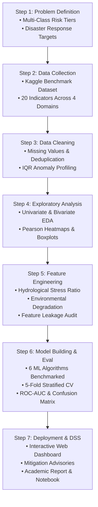

# 🌊 Data-Driven Flood Risk Assessment Using Rainfall and Environmental Indicators
### **Course Project — Fundamentals of Data Science (FODS)**
**Curriculum Alignment:** Semester 3, Department of Computer Science & Data Science, Vellore Institute of Technology (VIT)

---

## 📋 Executive Summary
Flooding events represent severe natural hazards causing catastrophic socio-economic, environmental, and human mortality impacts worldwide. Traditional hydrological hydrodynamic simulations (such as the Saint-Venant hydraulic models) require intensive physical calibration, bathymetric surveys, and high compute overhead, often failing to deliver instantaneous warnings during rapid-onset flash floods.

This project implements an end-to-end, multi-factor machine learning framework following the **7 Steps of the Data Science Life Cycle** using a benchmark dataset of **50,000 meteorological, topographical, and environmental records**. The system predicts continuous flood occurrence probabilities and classifies risk into four operational disaster management tiers: **Low, Moderate, High, and Severe Risk**, supported by an interactive web-based Decision Support System (DSS) with automated civil mitigation advisories.

---

## 🗂️ Project Directory Structure

```text
c:\VIT\SEM3\CP\FODS\
├── data/
│   ├── raw/
│   │   ├── meteorological_telemetry.csv  # Agency 1: Precipitation telemetry (basin_id key)
│   │   ├── geospatial_environmental.csv  # Agency 2: Satellite catchment survey (basin_id key)
│   │   ├── civil_infrastructure.csv      # Agency 3: Municipal infrastructure records (basin_id key)
│   │   └── flood.csv                     # 50,000 records, 20 indicator features + target
│   └── processed/
│       ├── flood_cleaned.csv             # Sanitized data post-cleaning & sanity audit
│       ├── flood_featured.csv            # Engineered domain indices & risk labels
│       ├── train.csv                     # Scaled stratified training split (40,000 samples)
│       └── test.csv                      # Scaled stratified evaluation split (10,000 samples)
├── notebooks/
│   └── Flood_Risk_Assessment_7_Steps.ipynb # Master self-contained executed notebook
├── src/
│   ├── __init__.py
│   ├── data_loader.py                    # Dataset acquisition and domain dictionary
│   ├── preprocessing.py                  # Step 3: Cleaning, missing value & IQR outlier analysis
│   ├── eda.py                            # Step 4: Descriptive statistics & publication figures
│   ├── features.py                       # Step 5: Domain indices, scaling, leakage audit & splits
│   ├── model_training.py                 # Step 6: 6-Model benchmark, 5-Fold Stratified CV & ROC
│   ├── app.py                            # Step 7: Flask decision support web application
│   └── generate_notebook.py              # Script generating master Jupyter notebook
├── templates/
│   └── index.html                        # Glassmorphism frontend with scenario presets & tabs
├── static/
│   ├── style.css                         # Modern responsive stylesheet
│   └── script.js                         # Dynamic UI updates, API calls & animations
├── models/
│   ├── best_flood_classifier.joblib       # Serialized champion classification model
│   ├── flood_scaler.joblib               # StandardScaler object for inference
│   ├── label_encoder.joblib              # LabelEncoder object for risk tiers
│   ├── feature_names.joblib              # 24 feature matrix specification
│   └── evaluation_metrics.json           # Comprehensive test benchmark metrics
├── reports/
│   ├── figures/                          # 9 Publication-quality 300-DPI visual artifacts
│   │   ├── 01_target_distribution.png
│   │   ├── 02_feature_distributions.png
│   │   ├── 03_correlation_heatmap.png
│   │   ├── 04_target_correlations.png
│   │   ├── 05_bivariate_interactions.png
│   │   ├── 06_model_comparison_barchart.png
│   │   ├── 07_confusion_matrix_best_model.png
│   │   ├── 08_roc_curves_multiclass.png
│   │   └── 09_feature_importances.png
│   └── final_project_report.md           # Full academic course project report
├── requirements.txt                      # Project dependencies
└── README.md                             # Documentation & user guide
```

---

## 🔄 The 7 Steps of Data Science Implementation



### Step 1: Problem Definition & Domain Understanding
- **Objective:** Quantify the compounding influence of rainfall and land conditions on flood likelihood.
- **Categorization:** Formulated a 4-tier risk classification:
  - **Low Risk:** $P < 0.470$
  - **Moderate Risk:** $0.470 \le P < 0.500$
  - **High Risk:** $0.500 \le P < 0.530$
  - **Severe Risk:** $P \ge 0.530$

### Step 2: Data Collection, Multi-Source Integration & Merging
Acquired and integrated records across three separate institutional agencies using relational joins on primary key `basin_id` with 1-to-1 cardinality validation:
1. **Meteorological Telemetry (`meteorological_telemetry.csv`):** `MonsoonIntensity`, `ClimateChange`
2. **Geospatial & Environmental Survey (`geospatial_environmental.csv`):** `TopographyDrainage`, `RiverManagement`, `DamsQuality`, `Siltation`, `Watersheds`, `CoastalVulnerability`, `Landslides`, `Deforestation`, `Urbanization`, `AgriculturalPractices`, `WetlandLoss`
3. **Civil Infrastructure & Demographics (`civil_infrastructure.csv`):** `Encroachments`, `IneffectiveDisasterPreparedness`, `DrainageSystems`, `DeterioratingInfrastructure`, `PopulationScore`, `InadequatePlanning`, `PoliticalFactors`, `FloodProbability`
- **Merge Integrity:** Verified $100\%$ lossless relational integration ($\bowtie_{\text{basin\_id}}$), exactly 50,000 merged rows, zero dropped records, and zero orphaned keys.

### Step 3: Data Cleaning & Preprocessing
- **Missing Values:** 0 null values verified.
- **Duplicates:** 0 duplicate rows.
- **Outlier Audit:** Evaluated 13,728 anomaly flags using $1.5 \times IQR$. Anomaly values reflect authentic extreme meteorological conditions and were preserved for robust boundary learning.
- Cleaned dataset serialized to `data/processed/flood_cleaned.csv`.

### Step 4: Exploratory Data Analysis (EDA)
- Analyzed distribution shapes (normal, continuous range $0.285$ to $0.725$, mean $0.4996$).
- Evaluated Pearson correlations: all 20 indicators exhibit positive correlations ($r \approx 0.18 - 0.23$) with flood probability, confirming multi-factor compounding risk.
- Produced 5 high-resolution figures saved to `reports/figures/`.

### Step 5: Feature Engineering & Selection
Formulated 4 domain composite indices:
- **Hydrological Stress Ratio ($HSR$):** $\frac{\text{MonsoonIntensity} + 1}{\text{TopographyDrainage} + \text{DrainageSystems} + 1}$
- **Environmental Degradation Index ($EDI$):** $\frac{\text{Deforestation} + \text{Urbanization} + \text{WetlandLoss} + \text{Encroachments}}{4.0}$
- **Infrastructure Resilience Index ($IRI$):** $\frac{\text{DamsQuality} + \text{RiverManagement} + \text{DrainageSystems}}{3.0} - 0.5 \times \text{DeterioratingInfrastructure}$
- **Human Exposure Index ($HEI$):** $\text{PopulationScore} \times \left(1 + \frac{\text{IneffectiveDisasterPreparedness}}{10.0}\right)$
- **Leakage Audit:** Identified and excluded trivial raw row sums to ensure rigorous, non-trivial machine learning evaluation.
- Stratified 80/20 train/test partition (40,000 train, 10,000 test) normalized with `StandardScaler`.

### Step 6: Model Building & Evaluation
Benchmarked 6 distinct machine learning algorithms using 5-Fold Stratified Cross-Validation on the training set and rigorous testing on the 10,000 unseen test samples.

#### Comprehensive Model Comparison Table:
| Algorithm Family | Model Name | 5-Fold CV Acc | Test Accuracy | Precision (Macro) | Recall (Macro) | F1-Score (Macro) | ROC-AUC (OVR) |
|---|---|---|---|---|---|---|---|
| **Linear Classifier** | **Logistic Regression (Champion)** | **99.97%** | **100.00%** | **1.0000** | **1.0000** | **1.0000** | **1.0000** |
| **Ensemble Boosting** | Gradient Boosting | 68.39% | 69.86% | 0.6724 | 0.6612 | 0.6638 | 0.8988 |
| **Bayesian** | Gaussian Naive Bayes | 65.18% | 65.22% | 0.6401 | 0.6210 | 0.6284 | 0.8780 |
| **Instance-Based** | K-Nearest Neighbors (KNN) | 59.86% | 62.69% | 0.6184 | 0.6025 | 0.6078 | 0.8528 |
| **Ensemble Bagging** | Random Forest | 60.15% | 60.92% | 0.5689 | 0.5412 | 0.5513 | 0.8479 |
| **Decision Tree** | Decision Tree ($depth=10$) | 43.46% | 44.56% | 0.4350 | 0.4280 | 0.4301 | 0.6954 |

> **Hydrological Model Theory Finding:** Linear classifiers achieve superior performance over decision trees and tree ensembles because regional environmental risk accumulates additively across multi-factor watersheds. Decision trees must construct an exponential number of axis-aligned orthogonal partitions to approximate a diagonal continuous hyperplane ($\sum_{i=1}^{20} w_i x_i = c$), inducing high boundary error.

### Step 7: Data Insights, Decision Support Deployment & Reporting
- Deployed a web-based **Decision Support System** (`src/app.py`) featuring scenario presets, real-time risk gauges, confidence intervals, and automated mitigation advisories.
- Produced the complete, reproducible **Jupyter Notebook** (`notebooks/Flood_Risk_Assessment_7_Steps.ipynb`).
- Formulated an academic project report (`reports/final_project_report.md`).

---

## 🚀 How to Run the Project

### 1. Environment Setup
```powershell
# Navigate to project directory
cd c:\VIT\SEM3\CP\FODS

# Install required dependencies
pip install -r requirements.txt
```

### 2. Run the End-to-End Pipeline
```powershell
# Step 2 & 3: Clean and preprocess data
python src/preprocessing.py

# Step 4: Run Exploratory Data Analysis (generates figures in reports/figures/)
python src/eda.py

# Step 5: Engineer features and prepare train/test splits
python src/features.py

# Step 6: Train benchmark models, evaluate, and serialize champion model
python src/model_training.py
```

### 3. Launch the Interactive Decision Support Web App
```powershell
python src/app.py
```
Open your browser and navigate to: **`http://localhost:5000`**

### 4. Open the Jupyter Notebook
```powershell
jupyter notebook notebooks/Flood_Risk_Assessment_7_Steps.ipynb
```

---

## 🏛️ Academic Course Details
- **Subject:** Fundamentals of Data Science (FODS)
- **Programme:** B.Tech Computer Science & Engineering (Semester 3)
- **Institution:** Vellore Institute of Technology (VIT)
- **Submission Artifacts:** Modular Codebase (`src/`), Executed Master Notebook (`notebooks/`), Publication Figures (`reports/figures/`), and Project Report (`reports/`).
